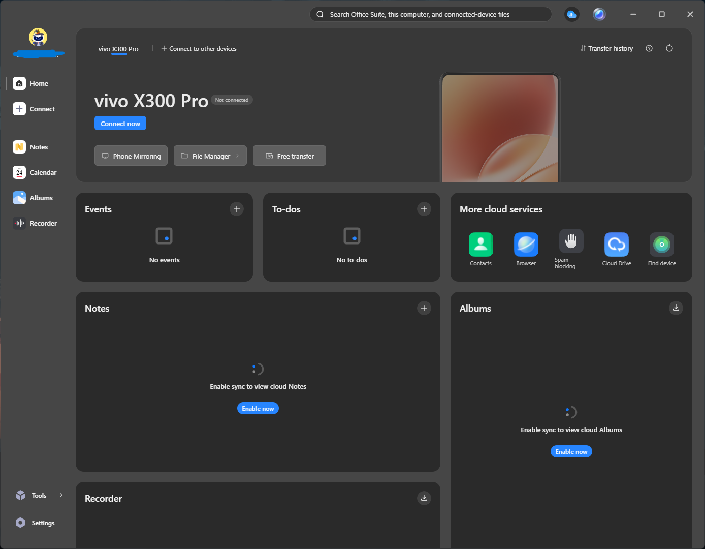
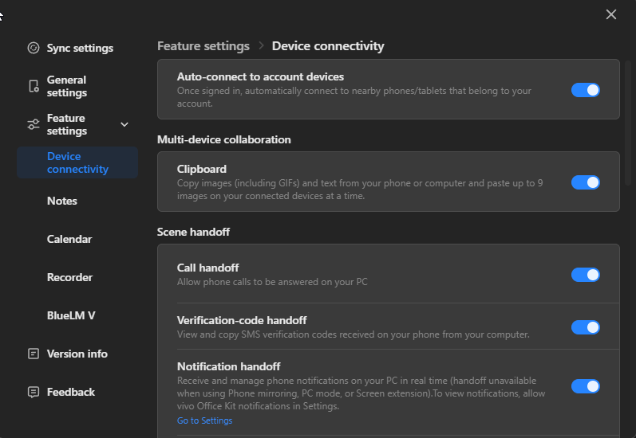
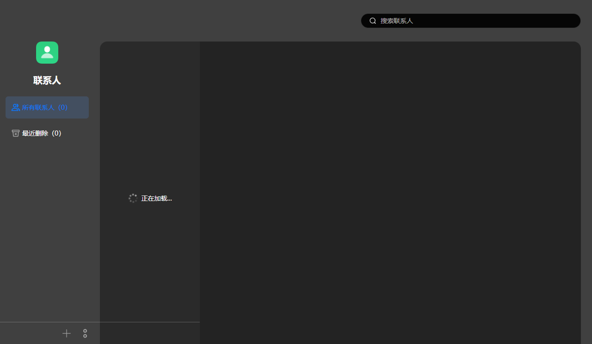
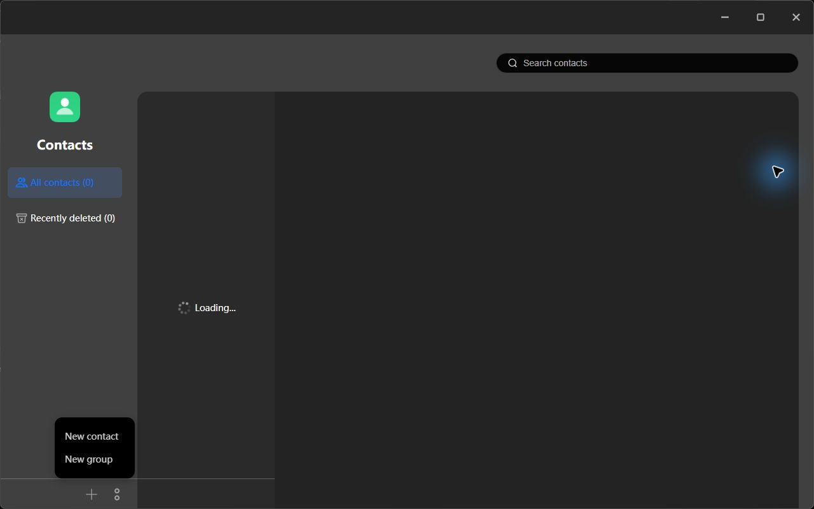
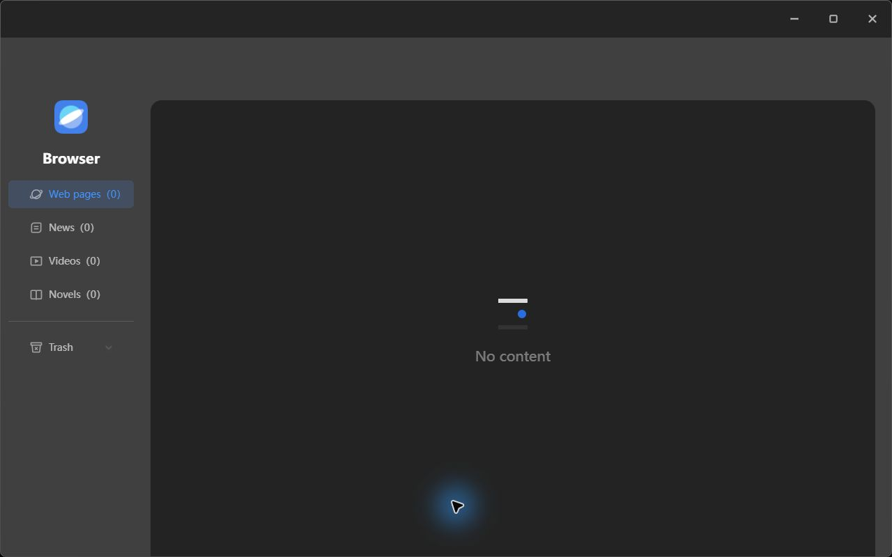
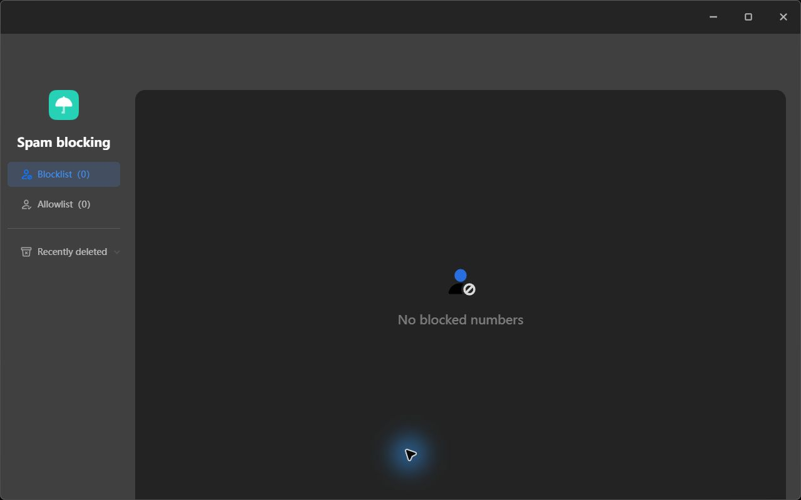

# Chinese vivo Office Suite — English localization

A community patch that translates the **Chinese interface into English** for **vivo Office Suite 7.0.6 on Windows**, including its hosted cloud service screens and a startup responsiveness fix.

**Patch release:** 1.0.0 · **Tested application:** 7.0.6 · **Test phone:** vivo X300 Pro over Wi-Fi

This is an independent community project, unaffiliated with vivo. Download and install the original Windows application from **[pc.vivo.com](https://pc.vivo.com/)** before applying this patch. The source repository provides patch recipes, localization helpers, dictionaries and tests. GitHub Releases also provides a ready-made modified `app.asar`; the official installer, external native binaries and personal profiles are not bundled.

## What changes

| Area | English coverage | Verification |
| --- | --- | --- |
| Desktop interface | Navigation, settings, connection prompts, Notes, Calendar, Tasks, Recorder, Albums, Documents and shared dialogs | Static validation, helper tests and selected runtime screens |
| Contacts | Sidebar, search, loading state, new/import/export menus | Real hosted screen and menu inspection; reload persistence |
| Browser | Bookmark navigation, fixed labels, empty state and Trash | Real hosted screen; reload persistence |
| Spam blocking | Blocklist, Allowlist, counts, deleted lists and empty states | Real hosted screen and layout inspection |
| Cloud Drive | Sidebar, search, toolbar, sort menu and empty states | Real hosted screen and sort menu inspection |
| Find Device | Device panel, fixed controls and map mode UI | Real hosted screen and redirect/reload persistence |
| Startup | Moves slow native hardware collection off the main process | Regression tests and measured isolated launches |

Cloud localization uses **511 fixed labels**, reviewed selectors and a mutation observer. It targets reviewed HTTPS service routes on `yun.vivo.com.cn` and `find.vivo.com.cn`. It preserves user content such as contact names, custom groups, bookmarks, filenames, folders, device names and map labels. It does not translate whole pages by sending their contents to a translation service.

The domestic backend setting remains `IS_EXPORT: false`. Region checks, authentication and device compatibility rules remain in place.

## Screenshots

Real screenshots from localization testing and user-supplied captures. These show the original Chinese interface and the translated English interface; no generated mockups are used.

### Home screen



### Device connectivity settings



The two screenshots above were supplied by the user; the account-name redaction is preserved.

### Cloud services and Chinese/English comparison

| Contacts — original Chinese | Contacts — translated English |
| --- | --- |
|  |  |

| Browser — translated English | Spam blocking — translated English |
| --- | --- |
|  |  |

The Contacts capture retains the known **Loading…** state; localization does not fix the hosted data-loading issue. Empty lists illustrate UI translation, not populated-data or transfer execution tests. Click an image to inspect it at full size. Find Device location captures and account details are excluded.

## Easy installation — no installer or commands

First download and install the **Windows software from [pc.vivo.com](https://pc.vivo.com/)**. Check the installed version: this patch is tested only on **7.0.6**. If the website offers a newer version, this release is not validated for it. No Node.js or developer tools are needed for the ready-made download.

1. **[Download app.asar.zip](https://github.com/MElmohandes/vivo-office-suite-english/releases/download/v1.0.0/app.asar.zip)** (about 122 MB). Right-click the downloaded ZIP, choose **Extract All**, and use the `app.asar` inside. Choose this asset, rather than Source code (zip).
2. Fully exit vivo Office Suite, including its icon beside the Windows clock.
3. Open `C:\Program Files (x86)\pcsuite\resources` in File Explorer (or your actual installation folder).
4. Rename the existing `app.asar` to `app.asar.backup`. If that backup name already exists, keep it and choose a new backup name.
5. Copy the extracted `app.asar` into that folder. Approve Windows administrator access if prompted.
6. Restart vivo Office Suite.

**Keep `app.asar.unpacked` and every other installed file in place.** To undo the change, exit the app, move the English archive aside and rename your backup back to `app.asar`.

The [beginner installation guide](docs/INSTALLATION.md) explains filename extensions, safe backups, optional checksum verification and troubleshooting. Advanced users can [build from source](docs/BUILD-FROM-SOURCE.md) to reproduce the exact same archive.

## Compatibility and checksums

The ready-made file was tested with the original archive below. The optional source builder accepts only that exact original. A matching displayed version alone cannot detect vendor repackaging; other builds have not been validated.

| Archive | Size (bytes) | SHA-256 |
| --- | ---: | --- |
| Original 7.0.6 input | 365,088,330 | `35ffb46ab7979ddc5250c66393dd6fb35210739dab4fd125a94462f72a7f96e0` |
| Tested English output | 394,510,622 | `c68629d20a5ef81eccdb5f46c37422f7d38d9b1a2518c73158ef5ae190a3e9cc` |

Other vivo versions, macOS, Linux, other phone models and other original 7.0.6 builds have not been validated. An app update can replace the patched archive; do not apply this recipe to a different build.

## Test status and limitations

The tested output contains **23,374 verified packed files**, with **5,485 external unpacked entries retained**. The patch reconstructs the exact tested output and checks every packed file and integrity block before writing it.

The localization regression suite contains 15 tests covering startup, local display formatting, cloud URL boundaries, labels and placeholders. Additional prior browser checks exercised five service fixtures, preservation of dictionary-equal user names, existing event listeners and quiet observer behavior. Three real reload checks covered Contacts, Browser and Find Device. See [validation](docs/VALIDATION.md) for the distinction between live checks and fixtures.

- Contacts retained a pre-existing persistent **Loading…** state during the live check. This patch translates it; it does not fix the hosted data-loading problem.
- Real cloud lists were empty in the test account. Populated content protection was checked with temporary DOM fixtures, not real contact/file mutations.
- Upload/download execution, saving contacts, creating groups, deleting data, sharing, account changes, verification challenges and Find Device ring/lock/erase were not exercised.
- Unvisited error dialogs, future hosted-site changes and separate native/AI components may still contain Chinese. Calendar Year view was not validated at the tested window size.
- Startup improvement was observed in an isolated test environment, not a controlled cold-boot benchmark. It is not a performance guarantee.

## Development

```powershell
npm test
```

No npm dependencies or install step are required. See [architecture](docs/ARCHITECTURE.md), [contributing](CONTRIBUTING.md) and the [changelog](CHANGELOG.md). Public CI runs synthetic/archive safety tests and helper regressions; the proprietary application is not available in CI.

## Project contents

```text
src/patch.cjs          Portable archive patch builder
src/runtime/           Runtime helpers included in the tested patch
src/cloud/             Hosted-page translation engine and reviewed configuration
patches/7.0.6.json      Hash-locked byte-copy/insert recipes for the tested build
translations/          Reviewed local and cloud translation data
test/                  Portable regression tests
tools/                 Recipe generation and archive verification
docs/                  Installation, architecture and validation notes
```

## Reporting problems

Open an issue with the app version, patch version, affected screen, reproduction steps and sanitized screenshots. Remove account identifiers, phone numbers, personal file contents, precise locations, cookies and tokens. Never attach a signed-in Electron profile or raw Find Device capture.

See [security reporting](SECURITY.md) for sensitive findings and [third-party notices](THIRD_PARTY_NOTICES.md) for ownership and licensing boundaries.
